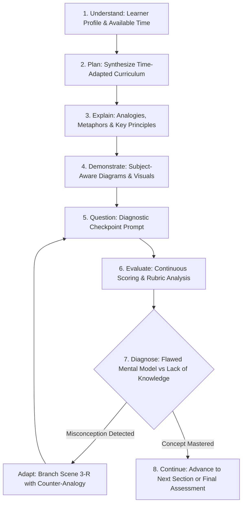
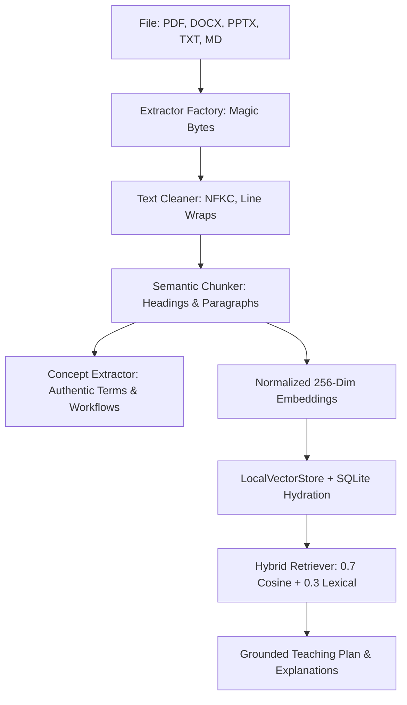

# 🎓 AI Teacher — Human-Like Adaptive AI Educator

> **AI Innovation Hackathon 2026 – Build Real-World AI Solutions**  
> **Submission Track:** *“AI Teacher: Build a Human-Like AI Educator That Teaches Through Video.”*  
> **One-Line Value Proposition:** *An active, multi-modal pedagogical educator that plans curricula, explains through analogies and subject-aware visuals, diagnoses cognitive misconceptions, synchronizes speech to an expressive avatar, and continuously adapts to learner understanding.*

---

## 📌 1. The Problem with Traditional Digital Learning

Modern online learning platforms and conversational AI chatbots suffer from systemic pedagogical shortcomings:

1. **Passive Chatbot Wrappers**: Most "AI tutors" are simple prompt wrappers (`User → LLM → Monolithic Text Response`). They only speak when spoken to and lack the agency to guide a structured lesson.
2. **Fixed, Rigid Explanations**: When a student does not understand an abstraction, the chatbot simply repeats the same definition with more words rather than deploying alternative pedagogical analogies or sensory representations.
3. **Binary Grading**: Automated graders mark answers as `Correct` or `Incorrect` (0 or 1). They cannot diagnose *why* a student answered incorrectly or detect underlying flawed mental models.
4. **Disjointed Multi-Modal Experience**: Avatars are typically decorative looping GIFs or static illustrations placed next to walls of text without lip-sync or directional awareness of the visual stage.
5. **Contextual Amnesia**: Lessons exist in isolation without persistent tracking of concept mastery vectors or longitudinal memory across learning sessions.

---

## 💡 2. The Solution: The 8-Step Pedagogical Teaching Cycle

The **AI Teacher** replaces conversational chat with an explicit **8-step stateful teaching loop** inspired by master human educators:

$$\textbf{Understand} \longrightarrow \textbf{Plan} \longrightarrow \textbf{Explain} \longrightarrow \textbf{Demonstrate} \longrightarrow \textbf{Question} \longrightarrow \textbf{Evaluate} \longrightarrow \textbf{Adapt} \longrightarrow \textbf{Continue}$$



> **Architectural Paradigm**: This system is built as an **application-level cognitive state machine**. The intelligence emerges from coordinating 8 specialized pedagogical modules and deterministic safeguards rather than throwing a single unconstrained prompt at a cloud LLM.

---

## ✨ 3. Core Implemented Capabilities

- **Topic & Syllabus-Based Teaching**: Teaches computer science, mathematics, electronics, machine learning, and general organizational workflows.
- **Learner Personalization**: Customizes explanations to learner educational levels (`beginner`, `intermediate`, `advanced`) and teaching styles (`analogy_driven`, `first_principles`, `visual`, `socratic`).
- **Dynamic Time-Adaptive Curriculum**: Restructures curriculum depth and section count based on available time (5 min sprint vs 15 min curriculum vs 60 min masterclass).
- **Document Intelligence & RAG Grounding**: Ingests `.pdf`, `.docx`, `.pptx`, `.txt`, and `.md` courseware, extracting headings, page numbers, and slide anchors.
- **Domain-Agnostic Concept Extraction**: Mines authentic operational concepts and workflows from uploaded documents to prevent unrelated domain leaks.
- **Auditable Citations**: Displays clickable source attribution badges with verbatim excerpts from uploaded documents.
- **Cognitive Misconception Detection**: Differentiates between simple lack of knowledge and active flawed mental models (e.g., node overgeneralization in Binary Trees).
- **Multi-Dimensional Answer Evaluation**: Continuous scoring (0.0 to 1.0) evaluating strengths, errors, and missing rubric components.
- **Adaptive Remediation Branching (Scene 3-R)**: Dynamically injects an alternative analogy and simplified visual into the video timeline upon student struggle.
- **Subject-Aware Visual Planning**: Renders discipline-specific interactive SVG diagrams (Binary Search Trees, Recursion Call Stacks, Neural Network Graphs, DC Circuits, Math Derivations, Code Viewers).
- **Interactive 4-Scene Teaching Sequence**: Structured scene progression (`intro` $\to$ `visual_explanation` $\to$ `analogy_walkthrough` $\to$ `checkpoint_prompt`).
- **Multilingual Presentation**: 6 languages supported with native script rendering: English (`en`), Hindi (`hi`), Tamil (`ta`), Telugu (`te`), Malayalam (`ml`), and Kannada (`kn`).
- **Bilingual STEM Mode**: Delivers explanations in the mother tongue while preserving global English technical terms (`Binary Tree`, `Root Node`, `O(log n)`).
- **Context-Preserving Mid-Lesson Language Switch**: Switches language mid-session without resetting section progress, mastery scores, or RAG citations.
- **Neural Speech Synthesis**: Powered by Microsoft Edge Neural TTS with sub-second word-boundary timestamp cues.
- **Lip-Synchronized Avatar Presenter**: Expressive teacher avatar articulating speech visemes (`OPEN`, `HALF_OPEN`, `NARROW`, `REST`) synchronized to the audio clock.
- **Pedagogical Action Gestures**: Directional pointing to visual diagrams, hand-on-chin contemplation during questions, and celebratory mastery poses.
- **Interactive Video Player**: Cinema timeline scrubber, speed multipliers (0.75x–1.5x), live karaoke subtitles, and reduced-motion accessibility toggles.
- **Cumulative Final Assessment**: Comprehensive multi-question assessment evaluating retention across all taught sections.
- **Diagnostic Learning Report & Dashboard**: Post-lesson mastery analytics, revision recommendations with rationales, and next-topic roadmap.
- **Relational Persistence**: 12 declarative entities stored in SQLite with Write-Ahead Logging (WAL) concurrency.

---

## 🌟 4. The Golden User Journey

```
[1. Onboarding] ──> [2. Ingest Document] ──> [3. Lesson Plan] ──> [4. Teaching Studio]
   Alex Chen           Upload lecture PDF        3 Sections           Lip-sync avatar &
   Beginner, 15m       "Binary_Trees.pdf"        Time-adapted         SVG Binary Tree
                                                                             │
[8. Dashboard]  <── [7. Assessment]      <── [6. Remediation] <── [5. Checkpoint]
   Mastery report      3-question final          Scene 3-R injected   Deliberate error:
   Next topic: BST     cumulative quiz           Bicycle rack analogy "Must have 2 nodes"
```

1. **Learner Setup**: Student Alex Chen specifies beginner level, 15 minutes available time, analogy-driven style, and selects **Binary Trees**.
2. **Document Ingestion**: Alex uploads `Binary_Trees_Lecture.md`. The RAG pipeline chunks, embeds, and indexes the document with 2 chunks.
3. **Personalized Lesson Plan**: The Lesson Planner synthesizes a 3-section curriculum: *Foundational Intuition*, *How It Works: Traversal & Operations*, and *Practical Applications & Trade-offs*.
4. **Teaching Studio Launch**: The cinema player begins with Scene 1. The avatar welcomes Alex; Scene 2 renders an interactive SVG tree; Scene 3 narrates an analogy while pointing to nodes.
5. **Diagnostic Checkpoint**: At Scene 4, the video halts automatically. Alex is asked: *"What is the maximum number of children any node can have?"* Alex selects Option C: *"Must always have exactly 2 children"*.
6. **Misconception Diagnosis & Adaptive Remediation**: The engine diagnoses an **overgeneralization misconception**. The orchestrator synthesizes and injects **Scene 3-R**, presenting the bicycle rack counter-analogy. Alex re-evaluates with the correct answer (Option B) and receives mastery credit.
7. **Cumulative Assessment**: Alex completes a 3-question comprehensive assessment at lesson conclusion.
8. **Learning Report & Dashboard**: The dashboard displays 100% mastery on node topology, prescribes revision on branching invariants, and recommends the next topic: *"Binary Search Trees (BST) & Self-Balancing Trees"*.

---

## 🏛️ 5. System Architecture

```
+-----------------------------------------------------------------------------------+
|                            FRONTEND WEB APPLICATION                               |
|          (React 19 + Vite 6 + Glassmorphic Vanilla CSS + Cinema Studio Player)    |
|   - Student Onboarding & Time Selector         - Lip-Synchronized Human Avatar    |
|   - Dynamic Curriculum Roadmap Navigator       - Interactive Visual Diagram Stage |
|   - Live Karaoke Subtitles & Audio Controls    - Diagnostic Checkpoint Drawer     |
|   - Mid-Lesson Language Switcher (6 Languages) - Post-Lesson Assessment Dashboard |
+------------------------------------------^----------------------------------------+
                                           | REST & Audio Streaming
+------------------------------------------v----------------------------------------+
|                               BACKEND API SERVICE                                 |
|            (Python 3.10+ + FastAPI + Uvicorn + Async SQLAlchemy 2.0 + SQLite WAL)  |
|   - Session Lifecycle Orchestrator             - Document Ingestion & Extraction  |
|   - Audio Asset Streaming & Subtitle Serving   - Speech Synthesis (Edge TTS / WAV)|
|   - Avatar Instantaneous State Evaluator       - Relational Database Persistence  |
+------------------------------------------^----------------------------------------+
                                           | In-Process Async Calls
+------------------------------------------v----------------------------------------+
|                                AI TEACHING ENGINE                                 |
|                    (Modular Pedagogical Subsystems + Pydantic Contracts)          |
|   +---------------------------------------------------------------------------+   |
|   | 1. Learner Profiler        2. Lesson Planner         3. Teaching Agent     |   |
|   | 4. Question Generator      5. Answer Evaluator       6. Misconception Det. |   |
|   | 7. Adaptation Engine       8. Session Orchestrator   9. Visual Planner     |   |
|   | 10. Language Controller    11. Avatar Controller     12. Concept Extractor |   |
|   +---------------------------------------------------------------------------+   |
|   +---------------------------------------------------------------------------+   |
|   |                           PROVIDER ABSTRACTION LAYER                      |   |
|   |   - LLMProvider (DeterministicTeachingProvider, GeminiLLMProvider)        |   |
|   |   - SpeechProvider (EdgeTTSProvider, MockSpeechProvider, Web Speech API)  |   |
|   |   - VectorStore & Retriever (LocalVectorStore, HybridRetriever)           |   |
|   +---------------------------------------------------------------------------+   |
+-----------------------------------------------------------------------------------+
```

---

## 🤖 6. AI & LLM Architecture

> [!IMPORTANT]
> **Honest Scope Notice**: This project does **NOT** train a proprietary foundation model from scratch. It implements application-level cognitive orchestration around existing foundation models and deterministic pedagogical modules.

### Provider Abstraction (`ai_engine/providers/`)
The system abstracts intelligence providers behind the `LLMProvider` contract:
- **`GeminiLLMProvider`**: Live cloud provider interfacing with Google Gemini 1.5 Flash using Pydantic V2 structured outputs (`generate_structured`).
- **`DeterministicTeachingProvider`**: 150 KB high-fidelity local engine providing offline curriculum planning, teaching narratives, diagnostic questions, and misconception diagnoses across multiple academic subjects.
- **Zero-Failure Fallback Guarantee**: If `GEMINI_API_KEY` is omitted or cloud requests time out, the system automatically routes all tasks to the deterministic provider with zero user disruption.

---

## 📚 7. Document Intelligence & RAG Subsystem



- **Format Parsers**: `pypdf>=5.1.0` (PDFs with page numbers), `python-docx>=1.1.2` (Word with heading hierarchies), `python-pptx>=1.0.2` (PowerPoint with slide indexes), native standard library for Markdown/Text.
- **Security Check**: Magic byte validation blocks dangerous executables (`.exe`, `.bin`, `.sh`, `.doc`).
- **Semantic Chunking**: Chunks along structural boundaries (~500 chars, 100 char overlap) preserving `document_id`, `page_number`, and `heading`.
- **Domain-Agnostic Concept Extraction**: Mines operational concepts from chunks so general documents (e.g. employee attendance) generate authentic curriculum sections rather than defaulting to data structures.
- **On-Demand SQLite Hydration**: `LocalVectorStore._sync_from_sqlite()` re-hydrates vector indices on demand when a session queries an existing database document.
- **Anti-Hallucination Safeguard**: Flags `insufficient_grounding: true` if retrieval confidence is below 0.20, falling back to foundational principles without hallucinating source facts.

---

## 🎨 8. Subject-Aware Visuals & AI Video Studio

The `VisualPlanner` (`ai_engine/modules/visual_planner.py`) inspects the topic and discipline to generate specialized visual representations:

| Academic Domain | Selected Visual Type | Interactive Features |
| :--- | :--- | :--- |
| **Data Structures** | `tree_diagram` | Interactive SVG Binary Search Tree with glowing nodes and traversal paths. |
| **Recursion** | `stack_diagram` | Call stack frame sequence with activation records and return value badges. |
| **Neural Networks / ML** | `neural_diagram` | Multi-layer node graph (Input $\to$ Hidden $\to$ Output) with edge weights. |
| **Electronics / Physics** | `circuit_diagram` | DC circuit schematic with battery, resistor, and Ohm's Law formula card. |
| **Mathematics** | `equation` | LaTeX mathematical derivation card with variable breakdown. |
| **Programming** | `code` | Syntax-highlighted code viewer with line indicators. |
| **General / Document** | `flowchart` | Sequential step-by-step workflow card sequence with source citations. |

---

## 🌐 9. Multilingual Voice & Lip-Synchronized Avatar

### Multilingual Capabilities (`ai_engine/modules/language_controller.py`)
- **6 Supported Languages**: English (`en`), Hindi (`hi`), Tamil (`ta`), Telugu (`te`), Malayalam (`ml`), Kannada (`kn`).
- **Bilingual STEM Mode**: Intuition and analogies are delivered in the native script while preserving core English technical terms (`Binary Tree`, `Root Node`, `Time Complexity O(log n)`).
- **Context-Preserving Language Switch**: Endpoint `POST /api/v1/teaching/sessions/{id}/language` updates presentation language mid-lesson without resetting topic, section progress, concept mastery, or RAG citations.

### Avatar Lip-Sync Engine (`ai_engine/modules/avatar_controller.py`)
The teacher avatar visually embodies pedagogical decisions:
$$\text{Teaching State} + \text{Teaching Scene} + \text{Audio Playback Clock} \longrightarrow \text{AvatarController} \longrightarrow \text{AvatarState}$$

- **Mouth Visemes**: Driven by sub-second word boundaries from Microsoft Edge Neural TTS (`OPEN` for vocal attack, `HALF_OPEN` for vowels, `NARROW` for consonants, `REST` for silence).
- **Pedagogical Gestures**: `point_to_visual` (directionally points at diagram), `ask_question` $\to$ `THINK` (hand on chin at checkpoints), `ENCOURAGING` (open supportive palms during remediation), `CELEBRATING` (raised arms upon concept mastery).
- **Accessibility**: First-class `Reduced Motion` mode disabling intense transitions while preserving full educational utility.

---

## 🗄️ 10. Relational Database Architecture

The system uses asynchronous SQLAlchemy 2.0 with SQLite configured in Write-Ahead Logging (`PRAGMA journal_mode=WAL`) across **12 declarative models** (`backend/database/models.py`):

1. `Student`: Learner identity, username, full name.
2. `StudentProfile`: Educational level, style preference, language, time limit, strengths, weaknesses.
3. `LearningSession`: Active session state, topic, section pointer, knowledge mode.
4. `Lesson`: Generated lesson plan, duration, learning objectives.
5. `LessonSection`: Section index, concept, difficulty, explanation outline, visual spec.
6. `Question`: Diagnostic checkpoint questions, options, rubric, hints.
7. `StudentResponse`: Submitted answer, score, evaluation data, misconception data, adaptation decision.
8. `Assessment`: Final cumulative assessment, score percentage, feedback summary.
9. `LearningProgress`: Quantitative completion percentage, questions correct/attempted.
10. `ConceptMastery`: Per-concept mastery score (0.0 to 1.0) and status (`introduced`, `practicing`, `mastered`, `struggling`).
11. `Document`: Uploaded document metadata, file type, page/chunk count, extraction status.
12. `DocumentChunk`: Text content, section heading, page/slide number, normalized embedding.

---

## 🔌 11. Complete REST API Reference

### Health & Readiness
| Method | Endpoint | Description |
| :--- | :--- | :--- |
| `GET` | `/health` | Basic service liveness check. |
| `GET` | `/api/v1/health` | Backend service health and database connectivity. |
| `GET` | `/api/v1/ai/health` | Pedagogical AI engine and provider health. |
| `GET` | `/api/v1/readiness` | Deep diagnostic readiness check verifying all 5 core subsystems. |

### Teaching & Session Lifecycle
| Method | Endpoint | Description |
| :--- | :--- | :--- |
| `POST` | `/api/v1/teaching/sessions` | Initialize a personalized teaching session. |
| `GET` | `/api/v1/teaching/sessions/{id}` | Retrieve active session state, current section index, and concept mastery. |
| `POST` | `/api/v1/teaching/sessions/{id}/plan` | Synthesize personalized, time-adapted lesson plan preview. |
| `POST` | `/api/v1/teaching/sessions/{id}/explain` | Generate conversational explanation for the current section. |
| `POST` | `/api/v1/teaching/sessions/{id}/question` | Pose diagnostic checkpoint question for the current section. |
| `POST` | `/api/v1/teaching/sessions/{id}/evaluate` | Evaluate student answer, diagnose misconceptions, and trigger adaptations. |
| `POST` | `/api/v1/teaching/sessions/{id}/advance` | Advance learner to the subsequent curriculum section. |
| `POST` | `/api/v1/teaching/sessions/{id}/assessment` | Generate cumulative final assessment covering all taught concepts. |
| `POST` | `/api/v1/teaching/sessions/{id}/assessment/submit` | Submit assessment answers and receive comprehensive score and grade. |
| `GET` | `/api/v1/teaching/sessions/{id}/report` | Retrieve post-lesson learning report with revision and next-topic recommendations. |
| `GET` | `/api/v1/teaching/sessions/{id}/dashboard` | Retrieve learner progress dashboard with mastery matrix. |

### Document Intelligence & RAG
| Method | Endpoint | Description |
| :--- | :--- | :--- |
| `POST` | `/api/v1/documents/upload` | Ingest educational document (`.pdf`, `.docx`, `.pptx`, `.txt`, `.md`). |
| `GET` | `/api/v1/documents` | List all uploaded documents with chunk counts and status. |
| `GET` | `/api/v1/documents/{document_id}` | Retrieve detailed document metadata and chunk index. |
| `POST` | `/api/v1/documents/query` | Execute hybrid semantic/lexical search query against indexed documents. |

### Media, Speech & Avatar
| Method | Endpoint | Description |
| :--- | :--- | :--- |
| `GET` | `/api/v1/media/languages` | Catalog of supported languages, native names, and scripts. |
| `GET` | `/api/v1/media/voices` | Catalog of neural TTS voices with locale and gender. |
| `GET` | `/api/v1/media/audio/{asset_id}` | Stream synthesized `.mp3` or `.wav` audio file. |
| `POST` | `/api/v1/teaching/sessions/{id}/scenes` | Generate 4-scene video presentation plan for the active section. |
| `GET` | `/api/v1/teaching/sessions/{id}/scenes` | Retrieve active scene plan and current scene index. |
| `POST` | `/api/v1/teaching/sessions/{id}/scenes/{scene_id}/render` | Render audio stream, avatar visemes, and visual specifications. |
| `POST` | `/api/v1/teaching/sessions/{id}/scenes/{scene_id}/speech` | Synthesize speech asset with word-level subtitle cues. |
| `POST` | `/api/v1/teaching/sessions/{id}/language` | Switch session teaching language mid-lesson while preserving state. |
| `POST` | `/api/v1/teaching/sessions/{id}/branch` | Synthesize and inject adaptive remediation scene (Scene 3-R). |
| `GET` | `/api/v1/teaching/sessions/{id}/scenes/{scene_id}/avatar-state` | Evaluate instantaneous avatar posture, emotion, mouth state, and gestures. |

---

## ⚡ 12. Local Installation & Quickstart

### System Prerequisites
- **Python 3.10+** (Tested on Python 3.11 and 3.13)
- **Node.js 18+** (Tested on Node v20 and v22) & npm
- **Operating System**: Windows (PowerShell), macOS, or Linux

---

### Step 1: Clone Repository & Backend Setup

```bash
# Clone the repository
git clone https://github.com/Shebha-M/ai-teacher.git
cd ai-teacher

# Create and activate Python virtual environment
python -m venv .venv

# On Windows (PowerShell):
.venv\Scripts\Activate.ps1
# On Linux / macOS:
# source .venv/bin/activate

# Install Python dependencies
python -m pip install --upgrade pip
pip install -r requirements.txt

# (Optional) Configure environment variables
# Copy .env.example to .env
# If GEMINI_API_KEY is omitted, the application operates 100% offline via local deterministic intelligence!
```

---

### Step 2: Start the FastAPI Backend Server

```bash
# Launch the backend server on port 8000
python -m uvicorn backend.main:app --reload --port 8000
```

Verify backend health in your browser:
- **Swagger Interactive API Docs**: `http://localhost:8000/docs`
- **Health Check**: `http://localhost:8000/health`
- **System Readiness Check**: `http://localhost:8000/api/v1/readiness`

---

### Step 3: Start the Frontend Web Application

Open a **new terminal**:

```bash
# Navigate to frontend directory
cd frontend

# Install Node dependencies
npm install

# Launch Vite development server (port 5173)
npm run dev
```

Open your browser to: **`http://localhost:5173`**

---

## 🧪 13. Automated Testing & Verification

The codebase is backed by comprehensive automated test suites:

### 1. Pytest Unit & Integration Suite
```bash
python -m pytest -v
```
- **67/67 Tests Passing** across 13 test files in ~6.3s.
- Validates lesson planning, misconception detection, answer evaluation, RAG extractors, chunkers, hybrid retrieval, concept extraction, SQLite hydration, media visuals, multilingual voice, avatar lip-sync, and API lifecycles.

### 2. End-to-End Golden Demo Journey (22 Steps)
```bash
python scripts/verify_final_demo.py
```
- **22/22 Steps Passing**: Validates session initialization, document ingestion, lesson planning, scene generation, visual specifications, speech synthesis, checkpoints, misconception evaluation, adaptive remediation branching, re-evaluation, section advancement, final assessment, learning report, mid-lesson language switch, and system readiness.

### 3. Frontend Production Build
```bash
cd frontend
npm run build
```
- Built cleanly in 1.82s: `dist/index.html` (1.16 kB), `dist/assets/index.css` (30.81 kB), `dist/assets/index.js` (275.66 kB) with zero warnings or errors.

---

## ⚠️ 14. Honest Technical Limitations

In accordance with hackathon evaluation integrity:

1. **Scanned PDF OCR**: The document extraction pipeline parses text and layout metadata from native digital documents (`.pdf`, `.docx`, `.pptx`, `.txt`, `.md`). It does not bundle an optical character recognition (OCR) engine for scanned photocopies or flat image-only PDFs.
2. **Microsoft Edge TTS Connectivity**: Real neural `.mp3` audio synthesis with sub-second word boundaries uses Microsoft's open Edge TTS WebSocket service. If the host machine is completely disconnected from the internet, the engine automatically falls back to local synthetic `.wav` audio and the browser's built-in `window.speechSynthesis`.
3. **SVG/React Reactive Presenter vs. Deepfake Video**: The AI Teacher avatar is an audio-synchronized, keyframe-animated vector presenter driven by real-time speech visemes and emotion states. It intentionally avoids heavy generative deepfake video models (e.g. SadTalker, HeyGen) to ensure **zero API latency**, **zero compute cost**, and **instant client rendering**.
4. **Single-Node SQLite Persistence**: The local database engine uses SQLite with Write-Ahead Logging (WAL). While ideal for local execution, edge devices, and desktop deployments, horizontal clustering across multiple servers would require migrating the SQLAlchemy connection string to PostgreSQL.

---

## 📖 15. In-Depth Documentation Index

For exhaustive technical and pedagogical specifications, refer to the `docs/` suite:

- [System Architecture & Full Technical Specification](docs/architecture.md)
- [Hackathon Rubric Mapping & Traceable Evidence](docs/rubric-mapping.md)
- [Live Presentation & Judge Demo Guide](docs/demo-guide.md)
- [Third-Party Services, Providers & Libraries](docs/third-party-services.md)
- [Document Intelligence & RAG Grounding Subsystem](docs/rag.md)
- [Core Teaching Intelligence & Cognitive Mechanics](docs/teaching_intelligence.md)
- [Media Architecture & Subject-Aware Visuals](docs/media-architecture.md)
- [Multilingual Teaching & Natural Voice Engine](docs/multilingual-voice.md)
- [Human-Like AI Teacher Avatar & Voice Synchronization](docs/avatar-architecture.md)

---

## ⚖️ License

Distributed under the MIT License. See `LICENSE` for details. Built for the AI Innovation Hackathon 2026.
