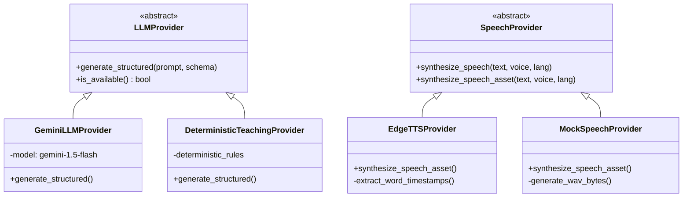
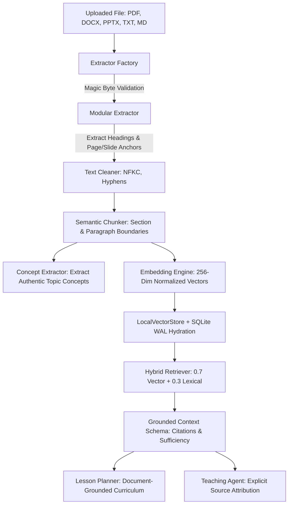
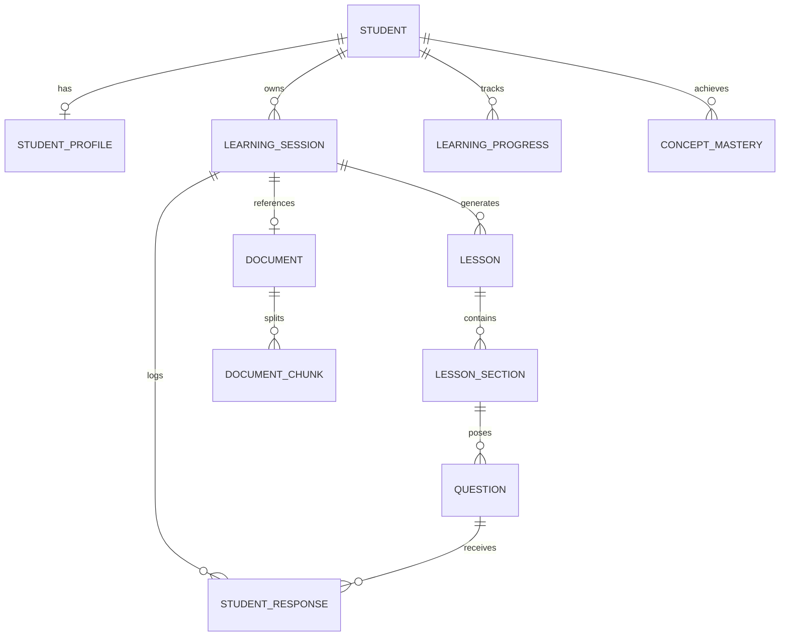

# AI Teacher — System Architecture & Specification

## 1. Executive Summary & Challenge Context

**AI Teacher** is engineered for the **AI Innovation Hackathon 2026 – Build Real-World AI Solutions**.
Challenge Theme: *"AI Teacher: Build a Human-Like AI Educator That Teaches Through Video."*

Traditional educational chatbots and digital learning tools operate as passive question-answering engines:
$$\text{User Prompt} \longrightarrow \text{Generic LLM} \longrightarrow \text{Monolithic Text Response}$$

This approach suffers from fundamental pedagogical limitations:
1. **Passive Nature**: The AI only speaks when asked, instead of actively driving a structured lesson.
2. **Fixed Explanations**: If a student fails to understand, the AI simply restates the same abstraction with more words.
3. **Binary Grading**: Answers are graded right/wrong without isolating cognitive misconceptions.
4. **No Visual Synchrony**: Text walls appear with static avatars or disjointed clip art.
5. **Amnesia**: Lessons reset without persistent mastery tracking or curriculum progression.

The AI Teacher replaces this with an **8-step stateful pedagogical teaching loop**:
$$\text{Understand} \longrightarrow \text{Plan} \longrightarrow \text{Explain} \longrightarrow \text{Demonstrate} \longrightarrow \text{Question} \longrightarrow \text{Evaluate} \longrightarrow \text{Adapt} \longrightarrow \text{Continue}$$

---

## 2. High-Level Architectural Overview

The AI Teacher platform consists of three decoupled architectural tiers:

```
+-----------------------------------------------------------------------------------+
|                            FRONTEND WEB APPLICATION                               |
|          (React 19 + Vite 6 + Glassmorphic Vanilla CSS + Cinema Studio Player)    |
|   - Student Onboarding & Time Selector         - Lip-Synchronized Human Avatar    |
|   - Dynamic Curriculum Roadmap Navigator       - Interactive Visual Diagram Stage |
|   - Live Karaoke Subtitles & Audio Controls    - Diagnostic Checkpoint Drawer     |
|   - Mid-Lesson Language Switcher (6 Languages) - Post-Lesson Assessment Dashboard |
+------------------------------------------^----------------------------------------+
                                           | REST & HTTP Streaming
+------------------------------------------v----------------------------------------+
|                               BACKEND API SERVICE                                 |
|            (Python 3.10+ + FastAPI + Uvicorn + Async SQLAlchemy 2.0 + SQLite WAL)  |
|   - Session Lifecycle Orchestrator             - Document Ingestion & Extraction  |
|   - Audio Asset Streaming & Subtitle Serving   - Speech Synthesis (Edge TTS / WAV)|
|   - Avatar Instantaneous State Evaluator       - Relational Database Persistence  |
+------------------------------------------^----------------------------------------+
                                           | In-Process Async Calls
+------------------------------------------v----------------------------------------+
|                                AI TEACHING ENGINE                                 |
|                    (Modular Pedagogical Subsystems + Pydantic Contracts)          |
|   +---------------------------------------------------------------------------+   |
|   | 1. Learner Profiler        2. Lesson Planner         3. Teaching Agent     |   |
|   | 4. Question Generator      5. Answer Evaluator       6. Misconception Det. |   |
|   | 7. Adaptation Engine       8. Session Orchestrator   9. Visual Planner     |   |
|   | 10. Language Controller    11. Avatar Controller     12. Concept Extractor |   |
|   +---------------------------------------------------------------------------+   |
|   +---------------------------------------------------------------------------+   |
|   |                           PROVIDER ABSTRACTION LAYER                      |   |
|   |   - LLMProvider (DeterministicTeachingProvider, GeminiLLMProvider)        |   |
|   |   - SpeechProvider (EdgeTTSProvider, MockSpeechProvider, Web Speech API)  |   |
|   |   - VectorStore & Retriever (LocalVectorStore, HybridRetriever)           |   |
|   +---------------------------------------------------------------------------+   |
+-----------------------------------------------------------------------------------+
```

---

## 3. The 8 Core Pedagogical Modules

The AI engine avoids single monolithic prompts by decomposing teaching into specialized modules bound by strictly-typed Pydantic V2 schemas:

| Module | Location | Primary Responsibility | Input Contract | Output Contract |
| :--- | :--- | :--- | :--- | :--- |
| **Learner Profiler** | `ai_engine/modules/learner_profiler.py` | Maintains student knowledge baseline, preferred style, strengths, weaknesses, and persistent misconceptions. | Student actions & history | `LearnerProfileSchema` |
| **Lesson Planner** | `ai_engine/modules/lesson_planner.py` | Dynamically synthesizes curriculum structure, section count, and depth based on available learning time (5m vs 15m vs 60m). | Topic, time limit, level | `LessonPlanSchema` |
| **Teaching Agent** | `ai_engine/modules/teaching_agent.py` | Formulates conversational explanations grounded in pedagogical analogies, concrete real-world examples, and visual cues. | Section concept & style | `TeachingResponseSchema` |
| **Question Generator** | `ai_engine/modules/question_generator.py` | Generates diagnostic checkpoint questions (multiple choice, conceptual, or problem-solving) calibrated to the target concept. | Section concept & difficulty | `QuestionSchema` |
| **Answer Evaluator** | `ai_engine/modules/answer_evaluator.py` | Performs multi-dimensional scoring (0.0 to 1.0), extracting identified strengths, specific errors, and rubric feedback. | Student response & rubric | `EvaluationResultSchema` |
| **Misconception Detector** | `ai_engine/modules/misconception_detector.py` | Isolates cognitive root causes, distinguishing between lack of knowledge and flawed mental models (e.g. overgeneralization). | Answer text & concept | `MisconceptionReportSchema` |
| **Adaptation Engine** | `ai_engine/modules/adaptation_engine.py` | Determines pedagogical interventions: `CHANGE_ANALOGY`, `RE_EXPLAIN`, `SIMPLIFY`, `GIVE_ANOTHER_EXAMPLE`, `MOVE_TO_NEXT_CONCEPT`. | Evaluation & diagnosis | `AdaptationDecisionSchema` |
| **Session Orchestrator** | `ai_engine/modules/session_orchestrator.py` | Coordinates the full teaching cycle, synchronizes media generation, manages concept mastery, and advances sections. | Session ID & student inputs | `TeachingSessionStateSchema` |

---

## 4. Provider Abstraction Architecture

To guarantee zero vendor lock-in and 100% offline self-sufficiency, the system isolates all AI, embedding, and speech generation behind abstract provider contracts (`ai_engine/providers/base.py`):



### Fallback Guarantee:
- **Cloud LLM**: If `GEMINI_API_KEY` is not provided or Google's API experiences network errors, the `SessionOrchestrator` seamlessly routes to `DeterministicTeachingProvider` without interrupting the student.
- **Neural TTS**: If `EdgeTTSProvider` cannot connect, `MockSpeechProvider` generates local synthetic `.wav` files with calculated syllable durations, while the frontend falls back to the browser's built-in `window.speechSynthesis`.

> **Critical Notice**: This project does NOT train a foundation model from scratch. It implements application-level cognitive orchestration around existing foundation models and deterministic pedagogical modules.

---

## 5. Document Intelligence & RAG Subsystem

The RAG subsystem (`ai_engine/rag/`) bridges external educational materials (textbooks, syllabus PDFs, slide decks) directly into the teaching cycle:



### Key Technical Characteristics:
1. **Multi-Format Ingestion**: Validates magic bytes (`%PDF`, `PK\x03\x04`) and file extensions (`.pdf`, `.docx`, `.pptx`, `.txt`, `.md`). Rejects unsafe executables (`.exe`, `.bin`, `.sh`, `.doc`).
2. **Semantic Chunking**: Chunks along structural section boundaries (~500 characters, 100 character adaptive overlap) preserving document metadata (`document_id`, `page_number`, `slide_number`, `heading`).
3. **Domain-Agnostic Concept Extraction**: Derives genuine topic components and workflows from document text rather than defaulting to generic data structure templates.
4. **SQLite-to-Memory Hydration**: `LocalVectorStore._sync_from_sqlite()` re-hydrates in-memory vectors dynamically when a session references an existing database document.
5. **Anti-Hallucination Threshold**: If the top retrieval score is below 0.20, `insufficient_grounding: true` is flagged, causing the teacher to explicitly acknowledge missing source context and fall back to foundational principles.

---

## 6. AI Teaching Video & Subject-Aware Visuals

Lessons are structured as **atomic 4-scene video plans** constructed by `VisualPlanner` (`ai_engine/modules/visual_planner.py`):

```
+-------------------------------------------------------------------------------+
|                             TEACHING SCENE PLAN                               |
+-------------------------------------------------------------------------------+
| Scene 1: INTRO (Welcoming)                                                   |
|   -> Frames learning objective, welcomes student by name.                     |
+-------------------------------------------------------------------------------+
| Scene 2: VISUAL EXPLANATION (Explaining)                                      |
|   -> Renders subject-aware diagram; teacher points to elements.               |
+-------------------------------------------------------------------------------+
| Scene 3: ANALOGY WALKTHROUGH (Explaining)                                     |
|   -> Traces elements while narrating real-world metaphor.                     |
+-------------------------------------------------------------------------------+
| Scene 4: CHECKPOINT PROMPT (Thoughtful)                                       |
|   -> Video pauses automatically; diagnostic checkpoint posed.                 |
+-------------------------------------------------------------------------------+
                                      |
                               [Misconception?]
                                      |
                                     YES
                                      v
+-------------------------------------------------------------------------------+
| Scene 3-R: ADAPTIVE REMEDIATION (Encouraging)                                 |
|   -> Injects concrete counter-analogy and alternative visual representation.   |
+-------------------------------------------------------------------------------+
```

### Subject-Aware Visual Schemas:
- **Data Structures**: Interactive SVG Binary Search Tree with glowing nodes and traversal paths.
- **Recursion**: Step-by-step Call Stack frame sequence with activation records and base case indicators.
- **Neural Networks / Machine Learning**: Layer architecture diagram (Input $\to$ Hidden $\to$ Output) with weighted synapses and activation formulas.
- **Physics / Electronics**: Schematic DC circuit with battery, resistor, and Ohm's Law relationship card.
- **Mathematics**: Step-by-step LaTeX derivation card with variable breakdown.
- **Programming**: Syntax-highlighted code viewer with line indicators.
- **General / Document**: Clean step-by-step workflow card sequence with source citations.

---

## 7. Multilingual Voice & Audio-Avatar Synchronization

### Multilingual Subsystem (`ai_engine/modules/language_controller.py`)
- **6 Supported Languages**: English (`en`), Hindi (`hi`), Tamil (`ta`), Telugu (`te`), Malayalam (`ml`), Kannada (`kn`).
- **Bilingual STEM Mode**: Delivers intuition and analogies in the native script while preserving core English technical terms (`Binary Tree`, `Root Node`, `Time Complexity O(log n)`).
- **Context-Preserving Language Switch**: Endpoint `POST /api/v1/teaching/sessions/{id}/language` updates presentation language mid-lesson without resetting topic, section progress, concept mastery, or RAG citations.

### Avatar Lip-Sync Engine (`ai_engine/modules/avatar_controller.py`)
The teacher avatar visually embodies pedagogical decisions:
$$\text{Teaching State} + \text{Teaching Scene} + \text{Audio Playback Clock} \longrightarrow \text{AvatarController} \longrightarrow \text{AvatarState}$$

```
Audio Clock:  0.00s ────────────────────────────────────────── 3.20s
Cues:         ["Look" 0.0-0.5s]  [gap]  ["closely" 0.6-1.2s] ...
Mouth State:  REST → OPEN → HALF_OPEN → NARROW → REST → OPEN ...
```

- **Mouth Visemes**: Driven by sub-second word boundaries (`OPEN` for vowels, `HALF_OPEN` for mid-vowels, `NARROW` for consonants, `REST` for pauses).
- **Pedagogical Gestures**: `point_to_visual` (directionally points at diagram), `ask_question` $\to$ `THINK` (hand on chin at checkpoints), `ENCOURAGING` (open supportive palms during remediation), `CELEBRATING` (raised arms upon concept mastery).
- **Accessibility**: Includes a `Reduced Motion` mode that calms animations for sensitive learners.

---

## 8. Relational Database Architecture (SQLite WAL)

The system persists state in SQLite configured with Write-Ahead Logging (`PRAGMA journal_mode=WAL`) via asynchronous SQLAlchemy 2.0 (`backend/database/models.py`):



### The 12 Declarative Entities:
1. `Student`: Learner identity, username, full name.
2. `StudentProfile`: Educational level, style preference, language, time limit, strengths, weaknesses.
3. `LearningSession`: Active session state, topic, section pointer, knowledge mode.
4. `Lesson`: Generated lesson plan, duration, learning objectives.
5. `LessonSection`: Section index, concept, difficulty, explanation outline, visual spec.
6. `Question`: Diagnostic checkpoint questions, options, rubric, hints.
7. `StudentResponse`: Submitted answer, score, evaluation data, misconception data, adaptation decision.
8. `Assessment`: Final cumulative assessment, score percentage, feedback summary.
9. `LearningProgress`: Quantitative completion percentage, questions correct/attempted.
10. `ConceptMastery`: Per-concept mastery score (0.0 to 1.0) and status (`introduced`, `practicing`, `mastered`, `struggling`).
11. `Document`: Uploaded document metadata, file type, page/chunk count, extraction status.
12. `DocumentChunk`: Text content, section heading, page/slide number, normalized embedding.

---

## 9. Comprehensive REST API Specification

### Health & System Readiness
- `GET /health` — Basic service liveness check.
- `GET /api/v1/health` — Detailed backend service status.
- `GET /api/v1/ai/health` — Pedagogical AI engine and provider health.
- `GET /api/v1/readiness` — Deep diagnostic readiness check verifying backend, AI engine, RAG engine, speech provider, and avatar controller.

### Teaching & Session Lifecycle
- `POST /api/v1/teaching/sessions` — Initialize a personalized teaching session with learner profile, topic, style, language, and knowledge mode.
- `GET /api/v1/teaching/sessions/{id}` — Retrieve active session state, current section index, and concept mastery.
- `POST /api/v1/teaching/sessions/{id}/plan` — Synthesize personalized, time-adapted lesson plan preview.
- `POST /api/v1/teaching/sessions/{id}/explain` — Generate conversational explanation for the current section.
- `POST /api/v1/teaching/sessions/{id}/question` — Pose diagnostic checkpoint question for the current section.
- `POST /api/v1/teaching/sessions/{id}/evaluate` — Evaluate student answer, diagnose misconceptions, and trigger adaptations.
- `POST /api/v1/teaching/sessions/{id}/advance` — Advance learner to the subsequent curriculum section.
- `POST /api/v1/teaching/sessions/{id}/assessment` — Generate cumulative final assessment covering all taught concepts.
- `POST /api/v1/teaching/sessions/{id}/assessment/submit` — Submit assessment answers and receive comprehensive score and grade.
- `GET /api/v1/teaching/sessions/{id}/report` — Retrieve post-lesson learning report with revision and next-topic recommendations.
- `GET /api/v1/teaching/sessions/{id}/dashboard` — Retrieve learner progress dashboard with mastery matrix.

### Document Intelligence & RAG
- `POST /api/v1/documents/upload` — Ingest educational document (`.pdf`, `.docx`, `.pptx`, `.txt`, `.md`), clean, chunk, embed, and index.
- `GET /api/v1/documents` — List all uploaded documents with chunk counts and status.
- `GET /api/v1/documents/{document_id}` — Retrieve detailed document metadata and chunk index.
- `POST /api/v1/documents/query` — Execute hybrid semantic/lexical search query against indexed documents.

### Media, Speech & Avatar
- `GET /api/v1/media/languages` — Catalog of supported languages, native names, and scripts.
- `GET /api/v1/media/voices` — Catalog of neural TTS voices with locale and gender.
- `GET /api/v1/media/audio/{asset_id}` — Stream synthesized `.mp3` or `.wav` audio file.
- `POST /api/v1/teaching/sessions/{id}/scenes` — Generate 4-scene video presentation plan for the active section.
- `GET /api/v1/teaching/sessions/{id}/scenes` — Retrieve active scene plan and current scene index.
- `POST /api/v1/teaching/sessions/{id}/scenes/{scene_id}/render` — Render audio stream, avatar visemes, and visual specifications.
- `POST /api/v1/teaching/sessions/{id}/scenes/{scene_id}/speech` — Synthesize speech asset with word-level subtitle cues.
- `POST /api/v1/teaching/sessions/{id}/language` — Switch session teaching language mid-lesson while preserving state and mastery.
- `POST /api/v1/teaching/sessions/{id}/branch` — Synthesize and inject adaptive remediation scene (Scene 3-R) into video timeline.
- `GET /api/v1/teaching/sessions/{id}/scenes/{scene_id}/avatar-state` — Evaluate instantaneous avatar posture, emotion, mouth state, and gestures.

---

## 10. Verification & Quality Assurance State

The system is validated through automated multi-layer test suites:

- **Unit & Integration Test Suite**: **67/67 tests passing** (`python -m pytest -q`) across 13 test suites in ~6.3 seconds.
- **End-to-End Golden Demo Suite**: **22/22 journey steps passing** (`python scripts/verify_final_demo.py`).
- **Frontend Production Build**: **Passed cleanly** (`npm run build` in `frontend/`) with zero warnings or errors in 1.82s.
- **System Readiness**: **OPERATIONAL** with all 5 core subsystems reporting ready.
