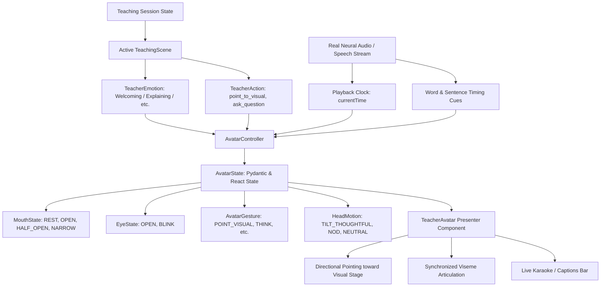

# Human-Like AI Teacher Avatar & Voice Synchronization Architecture

## 1. Overview & Core Principle

In **Phase 7**, the AI Teacher's presentation layer is elevated from a static/decorative SVG into an **audio-synchronized, emotion- and action-aware AI Educator Presenter**.

A central architectural tenet of this system is that **the avatar is NOT an independent AI brain**. The pedagogical truth resides strictly within the core teaching engine:

$$\text{Teaching State} + \text{Teaching Scene} + \text{Audio Timing} \longrightarrow \text{Avatar Controller} \longrightarrow \text{Avatar State}$$

The avatar acts as the expressive, human-like interface that visually embodies the pedagogical decisions made by the Lesson Planner, Teaching Agent, and Misconception Detector.

---

## 2. Architecture Diagram



---

## 3. Avatar State Model

The instantaneous presentation state is encapsulated in `AvatarState`:

```python
class AvatarState(BaseModel):
    emotion: TeacherEmotion = Field(TeacherEmotion.EXPLAINING)
    speaking: bool = Field(False)
    mouth_state: MouthState = Field(MouthState.REST)
    eye_state: EyeState = Field(EyeState.OPEN)
    head_motion: HeadMotion = Field(HeadMotion.NEUTRAL)
    gesture: AvatarGesture = Field(AvatarGesture.IDLE)
    speaking_progress: float = Field(0.0)
    scene_action: str = Field("explain")
    timing_mode: TimingMode = Field(TimingMode.DETERMINISTIC)
    reduced_motion: bool = Field(False)
    active_word: Optional[str] = Field(None)
```

### Supported Enums:

1. **`MouthState` (Speech Visemes)**:
   - `REST`: Lips gently closed or pleasant resting smile line.
   - `OPEN`: Wide vertical jaw opening for vowel articulation (e.g. *ah*, *oh*).
   - `HALF_OPEN`: Rounded mid-vowel shape (e.g. *eh*, *ih*).
   - `NARROW`: Compressed horizontal lip shape for consonants and sibilants (e.g. *m*, *p*, *s*, *oo*).

2. **`EyeState`**:
   - `OPEN`: Attentive eye contact with pupils and light specular highlights.
   - `BLINK`: Natural eyelid closure (150ms every 3.5 seconds).

3. **`AvatarGesture`**:
   - `IDLE`: Natural educator posture.
   - `WELCOME`: Inviting hand wave greeting the student.
   - `POINT_VISUAL` / `POINT_RIGHT`: Firm directional point toward the visual stage (SVG Binary Tree, Circuit, Code).
   - `POINT_LEFT`: Directional indication.
   - `EXPLAIN`: Open teacher presentation gesture.
   - `THINK`: Hand thoughtfully resting on chin while contemplating a student question.
   - `ENCOURAGE`: Warm open palms facing the student during reassurance.
   - `CELEBRATE`: Triumphant raised arms upon student concept mastery.

---

## 4. Audio-Synchronized Mouth Movement & Viseme Progression

Rather than generic looping animations, mouth visemes are driven directly by the audio playback clock and timing cues extracted from Phase 6 speech assets:

```
Audio Clock:  0.00s ────────────────────────────────────────── 3.20s
Cues:         ["Look" 0.0-0.5s]  [gap]  ["closely" 0.6-1.2s] ...
Mouth State:  REST → OPEN → HALF_OPEN → NARROW → REST → OPEN ...
```

### Progression within a Word:
- **0% – 25%**: `OPEN` (vocal attack)
- **25% – 65%**: `HALF_OPEN` (vowel resonance)
- **65% – 90%**: `NARROW` (consonant closure)
- **90% – 100%**: `REST` (inter-word boundary)

---

## 5. Graceful Timing Hierarchy & Honest Provider Representation

The system transparently reports and adapts to available timing precision:

| Tier | Source | Behavior | UI Badge |
| :--- | :--- | :--- | :--- |
| **High** | `EdgeTTSProvider` | Exact sub-second word boundaries from Microsoft Edge neural TTS | `🟢 Word-Sync (Edge TTS)` |
| **Medium** | Sentence Subtitles | Syllabic pacing based on sentence start/end timestamps | `🟡 Sentence-Sync` |
| **Client** | Web Speech API | Client-side interval-driven cadence (~4 syllables/sec) | `🔵 Web Speech` |
| **Idle** | Paused / Muted | Immediate snap to `REST` and `speaking = false` | `⏸️ Idle` |

---

## 6. Pedagogical State Integrations

### 1. Checkpoint Interruption Behavior
When the lesson reaches Scene 4 (Checkpoint Question):
1. Audio playback halts automatically.
2. Avatar speaking stops instantly (`speaking = false`, `mouth_state = REST`).
3. Avatar enters **`THINK` gesture** and **`THOUGHTFUL` emotion**, with head tilted thoughtfully toward the student.

### 2. Diagnostic Feedback Transitions
- **Correct Answer ($\ge 0.8$)**: Teacher immediately transitions to `CELEBRATING` emotion and celebratory raised posture.
- **Misconception / Struggling**: Teacher transitions to `ENCOURAGING` posture, delivering reassuring verbal and visual support.

### 3. Adaptive Remediation (Scene 3-R)
When an adaptive remediation branch is inserted:
- Teacher visibly changes presentation posture to `ENCOURAGE` (open supportive palms).
- Visual stage shifts to the alternative conceptual analogy (e.g. real-world hierarchy vs abstract graph).

---

## 7. Multilingual Avatar Stability

Changing language (English $\leftrightarrow$ Tamil $\leftrightarrow$ Hindi) preserves teacher identity and lesson context:
- **Teacher Identity**: "Prof. Sophia" remains the consistent educational presenter.
- **Progress Preservation**: Active section index, topic, and concept mastery are never reset.
- **Speech Sync**: The browser audio clock synchronizes seamlessly with Tamil or Hindi neural audio streams.

---

## 8. Accessibility & Reduced Motion

The interface includes a dedicated **Reduced Motion Toggle** (`⚡ Motion: Reduced`):
- Disables head tilts, nodding, and eye-blinking keyframes.
- Replaces CSS transitions with instantaneous posture snaps.
- Preserves 100% of educational content, subtitles, and interactive questions without visual distraction for motion-sensitive learners.

---

## 9. Reusable Frontend Architecture

The presentation layer is decoupled into modular components:
- `components/TeacherAvatar.jsx`: SVG vector renderer for face, glasses, eyebrows, visemes, and gestures.
- `components/SpeechSyncController.js`: Browser-side mathematical timing and viseme calculator.
- `components/TeacherStatus.jsx`: Professional presence card with live emotion badges, gesture indicators, fidelity badges, and accessibility toggles.
