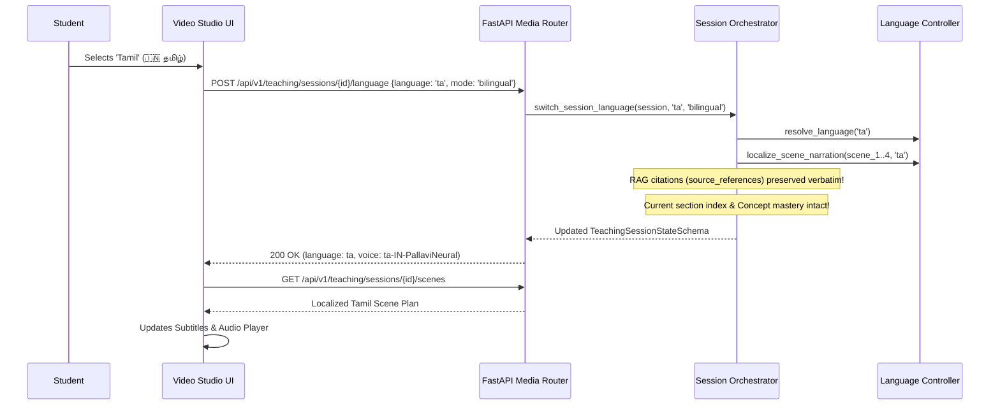

# Multilingual Teaching and Natural Voice Engine

## Overview

The **Multilingual Teaching and Natural Voice Engine** (Phase 6) elevates the AI Educator from an English-only text/mock presentation system into a culturally aware, multi-language educator with high-fidelity speech synthesis and synchronized visual subtitles.

Teaching is fundamentally a communicative and emotional endeavor. Learners across the globe grasp technical concepts faster and retain them longer when explained in their native language or through comfortable bilingual code-switching (e.g., Hinglish or Tanglish) where technical terminology remains crisp in English while intuition and analogies are conveyed in the mother tongue.

---

## Architecture Diagram

```mermaid
graph TD
    A[Teaching Session State] --> B[LanguageController]
    B --> C{Language Mode}
    C -->|Bilingual| D[Native Analogy + English Technical Terms]
    C -->|Full| E[Pure Native Script]
    C -->|Mixed| F[Conversational Code-Switching]
    
    D --> G[TeachingScene.narration]
    E --> G
    F --> G

    G --> H[SpeechProvider Abstraction]
    H --> I[EdgeTTSProvider: Real Neural Audio + Word Timings]
    H --> J[MockSpeechProvider: Offline Synthetic Audio]
    
    I --> K[Audio Asset Storage: storage/audio/*.mp3]
    K --> L[Stream Endpoint: /api/v1/media/audio/{id}]
    L --> M[Frontend Video Studio & Audio Player]
    I --> N[Synchronized Subtitle Cues]
    N --> O[Live Karaoke / Caption Bar]
```

---

## Supported Languages & Scripts

The system includes out-of-the-box support for 6 key educational languages with native script rendering:

| Code | Language | Native Name | Script | Default Voice | Available Voices |
| :--- | :--- | :--- | :--- | :--- | :--- |
| **`en`** | English | English | Latin | `en-US-AriaNeural` | `en-US-AriaNeural`, `en-US-GuyNeural` |
| **`hi`** | Hindi | हिन्दी | Devanagari | `hi-IN-SwaraNeural` | `hi-IN-SwaraNeural`, `hi-IN-MadhurNeural` |
| **`ta`** | Tamil | தமிழ் | Tamil | `ta-IN-PallaviNeural` | `ta-IN-PallaviNeural`, `ta-IN-ValluvarNeural` |
| **`te`** | Telugu | తెలుగు | Telugu | `te-IN-ShrutiNeural` | `te-IN-ShrutiNeural`, `te-IN-MohanNeural` |
| **`ml`** | Malayalam | മലയാളം | Malayalam | `ml-IN-SobhanaNeural` | `ml-IN-SobhanaNeural`, `ml-IN-MidhunNeural` |
| **`kn`** | Kannada | ಕನ್ನಡ | Kannada | `kn-IN-SapnaNeural` | `kn-IN-SapnaNeural`, `kn-IN-GaganNeural` |

---

## Language Presentation Modes

Learners can select their preferred presentation style per session:

1. **`bilingual` (Default & Recommended for STEM)**:
   - Explanations, metaphors, and greeting framing are delivered in the native language/script.
   - Core technical nouns, variable names, math formulas, and code snippets are preserved in English (e.g., `Binary Tree`, `Root Node`, `Left Child`, `Time Complexity O(log n)`).
   - This matches how top engineering educators teach across India and non-English universities.
2. **`full` (Complete Native Immersion)**:
   - Fully translates narration and onscreen text into the native script and educational vocabulary.
3. **`mixed` (Colloquial Code-Switching)**:
   - Uses conversational natural mixing (Hinglish/Tanglish), ideal for approachable, low-stress beginner tutoring.

---

## Speech Provider Architecture

The speech subsystem is fully abstracted via `SpeechProvider`:

```python
class SpeechProvider(ABC):
    @abstractmethod
    async def synthesize_speech(
        self, text: str, voice_id: Optional[str] = None, language: str = "en"
    ) -> SpeechResult: ...

    @abstractmethod
    async def synthesize_speech_asset(
        self, text: str, voice_id: Optional[str] = None, language: str = "en"
    ) -> AudioAsset: ...
```

### 1. `EdgeTTSProvider` (Production Default)
- Communicates asynchronously with Microsoft Edge neural TTS cloud services using the `edge-tts` engine.
- Generates high-fidelity `.mp3` audio files with zero API keys required.
- Extracts sub-second word-boundary and sentence-boundary timestamp cues directly into structured `SubtitleSegment` records.
- Automatically falls back to `MockSpeechProvider` if network is unavailable.

### 2. `MockSpeechProvider` (Offline / CI Mode)
- Generates deterministic, valid synthetic `.wav` audio using Python's standard library `wave` and `math` modules.
- Calculates synthetic syllable-based durations and subtitle boundaries.
- Enables 100% offline development, automated test execution, and CI pipeline runs.

### 3. Client-Side Web Speech API Fallback
- The React frontend Video Studio (`frontend/src/App.jsx`) supports instant client-side synthesis via `window.speechSynthesis` with accurate BCP-47 tags (`hi-IN`, `ta-IN`, etc.) when server streaming is disabled or offline.

---

## Context-Preserving Mid-Lesson Language Switch

Changing the teaching language mid-lesson **never** restarts the pedagogical flow:



### State Preservation Guarantees:
1. **Topic & Section Index**: Stays on the exact concept section being studied (e.g., Section 1 of Binary Trees).
2. **Concept Mastery Vector**: Mastery scores (0.0 to 1.0) and diagnosed learning gaps are never reset.
3. **Question & Remediation History**: Past diagnostic questions and student attempts remain logged.
4. **RAG Grounding Integrity**: All `source_references` (`filename`, `location`, `excerpt`) attached from uploaded courseware (e.g. `Binary_Trees_Lecture.md`) survive across language switches without corruption.

---

## Multilingual Student Answer Normalization

When a student answers a checkpoint question in Tamil, Hindi, or Telugu (e.g. `"இரண்டு கிளைகள் மட்டுமே இருக்க முடியும்"` or `"चार"`), the `LanguageController.normalize_student_answer` pipeline:
- Detects affirmative and negative markers across Indian scripts.
- Normalizes number words (e.g. "இரண்டு", "दो", "రెండు" -> "2").
- Cross-references normalized concepts against question rubrics and misconception patterns so the Answer Evaluator and Misconception Detector operate with high accuracy regardless of input tongue.

---

## REST API Endpoints

### 1. General Media & Voices
- `GET /api/v1/media/languages`: Returns all registered languages with native scripts and default voices.
- `GET /api/v1/media/voices?language=ta`: Lists all available neural voices for the specified language.
- `GET /api/v1/media/audio/{asset_id}`: Streams the generated MP3/WAV audio asset with caching headers.

### 2. Session Language & Audio Operations
- `POST /api/v1/teaching/sessions/{id}/language`: Switches the active language and re-localizes cached scene plans in-place.
- `POST /api/v1/teaching/sessions/{id}/scenes/{scene_id}/speech`: Synthesizes spoken audio for a specific scene using the session's active neural voice.

---

## Verification & Automated Testing

The multilingual system is covered by:
1. **Pytest Unit & Integration Suite** (`tests/test_multilingual_voice.py`):
   - Language resolution & fallbacks.
   - Voice catalog discovery.
   - STEM technical terminology preservation.
   - RAG citation retention across language switches.
   - Context-preserving language switches.
   - Multilingual question localization and answer evaluation.
   - Speech synthesis and subtitle timing metadata.
2. **End-to-End 16-Step Verification Script** (`scripts/verify_phase6_multilingual_voice.py`):
   - Validates the entire pedagogical lifecycle: English initialization -> Edge TTS synthesis -> Subtitle cue verification -> Tamil switch -> RAG citation validation -> Tamil checkpoint question -> Misconception evaluation -> Tamil remediation scene -> Hindi switch -> Session continuity verification.
